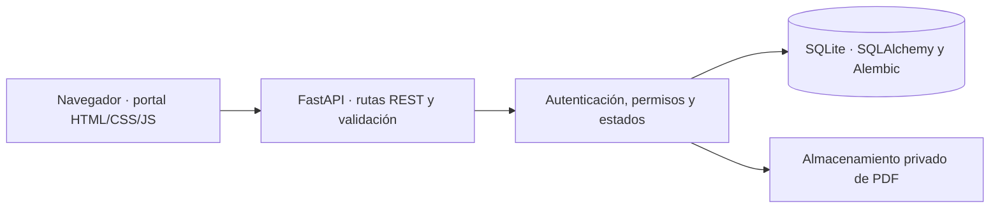

# Radivela | Informe final

## 1. Información General

| Dato | Información |
|---|---|
| Proyecto | Radivela, portal de solicitudes de servicio |
| Problema seleccionado | Las solicitudes llegan por correo, teléfono y WhatsApp. Su dispersión dificulta identificar el estado, el responsable y los tiempos de atención. |
| Integrantes y contribución | Gleidi Andrea Espinosa Lastra. Desarrollé el proyecto de forma individual. Véase el [detalle de aportes](#8-control-de-versiones). |
| Asignatura | Aplicaciones y servicios web |
| Fecha de entrega | 18/11/2026 |
| Repositorio | [Gegaela1/Radivela_solicitudes_de_servicio](https://github.com/Gegaela1/Radivela_solicitudes_de_servicio) |

## 2. Descripción del Sistema

Diseñé Radivela para registrar cada solicitud con un radicado único y conservar las actuaciones. El titular consulta el caso y su respuesta. Atención lo revisa y tramita, y coordinación administra la asignación y supervisa plazos.

| Actor | Funciones |
|---|---|
| Solicitante | Radicar, consultar, corregir o cancelar una solicitud recibida, responder requerimientos, descargar documentos y solicitar reapertura. |
| Atención | Revisar, pedir complementos, aceptar o rechazar. El responsable asignado registra y finaliza el trámite. |
| Coordinación | Registrar personal, asignar solicitudes, resolver reaperturas, ajustar prioridades y plazos, y supervisar casos. |

Definí el alcance de la implementación en RF-01 a RF-18. Restringí la consulta a sesiones autorizadas, exigí un PDF para los certificados expedidos y usé una base y un almacenamiento locales. [Especificación de requisitos](docs/requisitos.md)

## 3. Requisitos y Alcance

Realicé una entrevista escrita en Microsoft Teams con el docente Juan Carlos Morales Guerra. Registré sus respuestas sobre JWT, los datos de radicación, los roles, la evaluación, la asignación, el cierre y la supervisión. A partir del flujo que me describió, definí los estados, los plazos y las reglas de entrega de documentos. [Entrevista y capturas de Teams](evidencias/entrevista/README.md) · [Registro de levantamiento](docs/requisitos.md#registro-de-levantamiento)

Prioricé el acceso y la radicación, luego la gestión del trámite y, por último, el seguimiento. Implementé RF-01 a RF-18 y dejé WhatsApp como ampliación opcional (RF-19).

| Orden | Historia de usuario | Requisitos | Criterio de aceptación representativo |
|---|---|---|---|
| 1 | Como solicitante, quiero iniciar sesión, radicar y recuperar mi solicitud. | RF-01 a RF-05 | El envío válido devuelve un radicado. Su titular puede consultarlo con sesión, y el acceso de otro titular devuelve 404. Solo coordinación puede dar de alta al personal. |
| 2 | Como titular, quiero corregir o cancelar un caso recién recibido. | RF-06, RF-07 | Ambas acciones están disponibles antes de iniciar la revisión. Una vez iniciada, se rechazan con 409. |
| 2 | Como responsable de atención, quiero revisar la solicitud y retomarla después del complemento. | RF-08 a RF-10 | Si falta información, el caso espera un texto o PDF. Al aportarlo, vuelve a revisión. Solo coordinación asigna. |
| 3 | Como titular, quiero consultar el historial, enterarme del resultado y recuperar mi PDF. | RF-11 a RF-14 | Los movimientos aparecen en orden cronológico. La respuesta se conserva y el PDF se entrega solo a personas autorizadas. |
| 3 | Como coordinación, quiero resolver reaperturas y gestionar casos duplicados. | RF-15, RF-16 | El titular puede pedir reapertura dentro de diez días hábiles. El duplicado conserva el vínculo con un radicado distinto del mismo titular. |
| 3 | Como coordinación, quiero definir plazos y revisar los indicadores. | RF-17, RF-18 | Un cambio de política se aplica a solicitudes nuevas y el consolidado devuelve totales que coinciden con los filtros. |

Consulta los criterios completos y la prueba asociada a cada RF. [Matriz de requisitos](docs/requisitos.md#matriz-de-requisitos-funcionales)

## 4. Arquitectura, Diseño de API y Modelo de Datos



| Tecnología | Responsabilidad y motivo de uso |
|---|---|
| HTML, CSS y JavaScript | Sirven el portal en el mismo origen que la API para simplificar el despliegue local. |
| FastAPI y Pydantic | Exponen las operaciones REST, validan entradas y generan la documentación OpenAPI. |
| JWT y Argon2 | Identifican una sesión con expiración y almacenan un hash de las contraseñas. La API valida permisos en cada operación protegida. |
| SQLite, SQLAlchemy y Alembic | Persisten relaciones y movimientos en un archivo local y permiten preparar o actualizar el esquema con migraciones versionadas. |

Modelé la relación entre el usuario y sus solicitudes para que cada titular pueda radicar más de un trámite. Cada solicitud pertenece a un servicio y puede tener eventos, requerimientos, documentos, cierres y reaperturas. Los avisos identifican a su destinatario y al evento que los originó. Un duplicado conserva la referencia a su solicitud principal. El diagrama entidad–relación, la máquina de estados y los contratos completos están en el [diseño técnico](docs/diseno.md).

[Captura de Mis solicitudes](evidencias/evidencia-listado.png) · [Captura del detalle y de la respuesta](evidencias/evidencia-g12.png)

## 5. Configuración del Entorno

**Requisitos:** Python 3.12 y PowerShell. Git permite revisar el historial. Node.js se usa para la prueba automatizada del navegador.

1. Extrae el ZIP y abre en Visual Studio o VS Code la carpeta `Radivela` que contiene este README.
2. Abre PowerShell en esa carpeta y ejecuta `py -3.12 --version`. Si el lanzador indica que falta esa versión, ejecuta `py install 3.12` y confirma la versión antes de continuar.
3. Crea el entorno, instala las dependencias y aplica las migraciones.

```powershell
py -3.12 -m venv .venv
if ($LASTEXITCODE -ne 0) { throw 'No se pudo crear el entorno de Python 3.12.' }
$python = '.\.venv\Scripts\python.exe'
& $python -m pip install -r requirements.txt
if ($LASTEXITCODE -ne 0) { throw 'Falló la instalación de dependencias.' }

if (-not (Test-Path -LiteralPath '.env')) {
    Copy-Item -LiteralPath '.env.example' -Destination '.env'
}
$envPath = Join-Path $PWD '.env'
$config = [IO.File]::ReadAllText($envPath)
if ($config -match '(?m)^RADIVELA_SECRET[ \t]*=[ \t]*\r?$') {
    $secret = & $python -c 'import secrets; print(secrets.token_hex(32))'
    if ($LASTEXITCODE -ne 0 -or -not $secret) { throw 'Falló la generación del secreto.' }
    $config = [regex]::Replace($config, '(?m)^RADIVELA_SECRET[ \t]*=[ \t]*\r?$', "RADIVELA_SECRET=$secret")
    [IO.File]::WriteAllText($envPath, $config)
}
& $python -m alembic upgrade head
if ($LASTEXITCODE -ne 0) { throw 'No se pudieron aplicar las migraciones.' }
```

Conserva `.env`, las bases y los PDF fuera de Git. `RADIVELA_DB` indica el archivo SQLite y `RADIVELA_STORAGE` el directorio privado de documentos.

### Ejecución y datos ficticios

En la misma terminal, crea las tres cuentas ficticias y arranca el servidor. El script pide una contraseña local de al menos diez caracteres y genera un certificado ficticio.

```powershell
& $python -m scripts.demo
if ($LASTEXITCODE -ne 0) { throw 'No se pudo preparar la demostración.' }
& $python -m uvicorn app.main:app --host 127.0.0.1 --port 8000
```

Abre [el portal](http://127.0.0.1:8000/) y usa `ana@example.com` como solicitante, `atencion@example.com` para atención o `coord@example.com` para coordinación. El [guion](docs/demo.md) indica qué hacer con cada perfil. Para inicializar solo la primera cuenta coordinadora, ejecuta `& $python -m app.seed` en lugar de `scripts.demo`. Detén el servidor con `Ctrl+C`.

Uvicorn sirve el frontend en `/` y el backend en `/api/v1` con el mismo comando. `RADIVELA_SECRET` firma los JWT y debe contener al menos 32 bytes.

## 6. Servicios Web Implementados

Todas las rutas de la tabla usan el prefijo `/api/v1`. Con el servidor activo, la [documentación interactiva OpenAPI](http://127.0.0.1:8000/docs) permite revisar los contratos y repetir las llamadas. Para las operaciones protegidas, envía `Authorization: Bearer <token>`. Las transiciones de caso reciben la última `version` observada.

| Método | Ruta | Descripción | Requisito relacionado |
|---|---|---|---|
| `GET` | `/salud` | Comprobar disponibilidad de la API | Operación |
| `POST` | `/auth/registro` | Crear cuenta de solicitante | RF-01 |
| `POST` | `/auth/login` | Obtener JWT | RF-02 |
| `POST` | `/personal` | Dar de alta al personal | RF-03 |
| `GET` | `/personal` | Listar responsables habilitados | RF-10, RF-15, RF-18 |
| `GET` | `/servicios` | Consultar catálogo y plazos | RF-04, RF-17 |
| `POST` | `/solicitudes` | Radicar una solicitud | RF-04 |
| `GET` | `/solicitudes` | Listar solicitudes propias | RF-05 |
| `GET` | `/solicitudes/{radicado}` | Consultar el detalle | RF-05 |
| `PATCH` | `/solicitudes/{radicado}` | Corregir una solicitud recibida | RF-06 |
| `POST` | `/solicitudes/{radicado}/cancelar` | Cancelar una solicitud recibida | RF-07 |
| `GET` | `/bandeja` | Listar casos disponibles para atención | RF-08 |
| `POST` | `/solicitudes/{radicado}/revision` | Iniciar revisión | RF-08 |
| `POST` | `/solicitudes/{radicado}/evaluacion` | Aceptar, rechazar o pedir información | RF-08 |
| `POST` | `/solicitudes/{radicado}/complementos` | Responder el requerimiento | RF-09 |
| `POST` | `/solicitudes/{radicado}/asignacion` | Asignar responsable | RF-10 |
| `GET` | `/solicitudes/{radicado}/historial` | Consultar movimientos | RF-11 |
| `GET` | `/avisos` | Consultar avisos propios | RF-12 |
| `PATCH` | `/avisos/{notice_id}` | Marcar un aviso como leído | RF-12 |
| `POST` | `/solicitudes/{radicado}/finalizacion` | Finalizar y registrar la respuesta | RF-13, RF-14 |
| `GET` | `/solicitudes/{radicado}/documentos/{document_id}` | Descargar un documento autorizado | RF-14 |
| `POST` | `/solicitudes/{radicado}/reaperturas` | Solicitar reapertura | RF-15 |
| `PATCH` | `/reaperturas/{reopening_id}` | Resolver reapertura | RF-15 |
| `POST` | `/solicitudes/{radicado}/duplicado` | Cerrar un duplicado con su vínculo | RF-16 |
| `PATCH` | `/servicios/{service_id}` | Actualizar prioridad y plazo | RF-17 |
| `GET` | `/supervision` | Consultar solicitudes y métricas con filtros | RF-18 |

Ejemplo reproducible desde otra terminal PowerShell, con el servidor y los datos de demostración activos.

```powershell
$api = 'http://127.0.0.1:8000/api/v1'
$login = @{
    correo = 'ana@example.com'
    contrasena = Read-Host 'Contraseña de demostración'
} | ConvertTo-Json
$auth = Invoke-RestMethod "$api/auth/login" -Method Post -ContentType 'application/json' -Body $login
$headers = @{ Authorization = "Bearer $($auth.access_token)" }

$payload = @{
    nombre = 'Ana de prueba'
    documento = 'DEMO-01'
    correo = 'ana@example.com'
    servicio_id = 1
    asunto = 'Consulta de demostración'
    descripcion = 'Solicito información sobre los pasos del trámite.'
}
$body = $payload | ConvertTo-Json
$case = Invoke-RestMethod "$api/solicitudes" -Method Post -Headers $headers -ContentType 'application/json' -Body $body
Invoke-RestMethod "$api/solicitudes/$($case.radicado)" -Headers $headers
```

Para verificar un error controlado, ejecuta `$payload.Remove('asunto')` y repite el POST convirtiendo nuevamente `$payload` a JSON. La API devuelve `422` y el formulario incompleto no se guarda.

### Ejemplo de respuesta

El POST válido devuelve HTTP 201. Este fragmento muestra los campos que permiten consultar o modificar el caso.

```json
{
  "radicado": "RAD-2026-97216FBCF409486D",
  "servicio_id": 1,
  "asunto": "Consulta de demostración",
  "estado": "Recibida",
  "version": 1
}
```

Un POST sin asunto devuelve HTTP 422 con un detalle que identifica `body.asunto`. El correo debe tener formato válido. Los campos obligatorios deben tener contenido y el servicio seleccionado debe existir y estar disponible. Los PDF se validan antes de asociarlos al caso.

| Código HTTP | Ejemplo |
|---|---|
| `401` | Falta el token o la sesión venció. |
| `403` | Una cuenta de atención intenta asignar un responsable sin el rol de coordinación. |
| `404` | El radicado no existe o pertenece a otro titular. |
| `409` | El correo ya existe o se intenta guardar una versión anterior del caso. |
| `413` | El PDF supera 10 MiB. |
| `415` | El documento adjunto no es un PDF válido. |
| `422` | Falta un campo obligatorio o se intenta cerrar un certificado expedido sin adjuntar el PDF. |

## 7. Pruebas de API e Integración y Evidencias de Funcionamiento

| Caso | Requisito | Acción y resultado observado |
|---|---|---|
| G01–G02, PF-04 | RF-04 | Radicación válida: 201 con un radicado. Sin asunto: 422. |
| G06, PF-10 | RF-02, RF-10 | Asignar con una cuenta de atención devuelve 403. Con coordinación devuelve 200 y el caso pasa a En atención. |
| PF-09 | RF-09 | PDF ausente: 422. Archivo incompatible: 415. PDF válido: 200 y regreso a revisión. |
| G09, PF-13–PF-14 | RF-13, RF-14 | Finalizar certificado sin adjunto: 422. Con PDF: 200. La descarga de otro titular devuelve 404. |
| PF-15–PF-17 | RF-15–RF-17 | Reapertura duplicada pendiente: 409. Vínculo de duplicado válido: 200. El plazo de casos existentes se conserva. |
| G10–G11 | RF-18, RNF-02, RNF-03 | Consolidado filtrado: 200. El trámite y el PDF se recuperan con 200 después de reiniciar Uvicorn. |
| G12 | RF-04, RF-08–RF-10, RF-13, RF-14 y RF-18 | Tres sesiones en navegador verifican radicación, complemento, asignación, cierre, descarga y supervisión. |

### Reproducción

```powershell
$python = '.\.venv\Scripts\python.exe'
& $python -m pip install -r requirements-dev.txt
& $python -m pytest -q -s
```

Ejecuté las pruebas automatizadas sobre una base temporal para comprobar el flujo, los permisos y el calendario. Usé tres sesiones de navegador para verificar el recorrido completo desde cada rol. Consulta los [resultados por escenario](docs/pruebas.md), el [registro HTTP](evidencias/evidencia-http.txt), el [registro del navegador](evidencias/evidencia-navegador.txt) y la [captura del listado](evidencias/evidencia-listado.png).

En Swagger UI, autentícate con `POST /auth/login` y autoriza el JWT con **Authorize**. Para repetir G02, envía la radicación de la sección anterior sin `asunto` y comprueba el 422. Para repetir el flujo con tres perfiles y volver a generar la evidencia, sigue el [guion de navegador](docs/demo.md#g12-automatizado). El [registro completo de G01–G12 y PF-01–PF-18](docs/pruebas.md) incluye precondiciones y resultados. La [matriz de trazabilidad](docs/trazabilidad.md) relaciona los casos con los requisitos.

## 8. Control de Versiones

Realicé el levantamiento, el diseño, el desarrollo y la verificación como parte de mi entrega individual. Organicé el historial por requisito para que se pueda revisar con `git log --oneline --all`. Las [ramas y los componentes por requisito](docs/trazabilidad.md#ramas-componentes-y-pruebas-por-requisito) permiten localizar cada cambio.

| Aporte incluido | Referencia |
|---|---|
| Análisis del trámite y especificación | [RF-01 a RF-18](docs/requisitos.md) |
| API, estados del caso y persistencia | [Rutas](app/routes.py) y [migraciones](migrations/versions/) |
| Interfaz y operaciones por rol | [Código del portal](app/web/) |
| Verificación y sustentación | [Pruebas reproducibles](tests/) y [guion](docs/demo.md) |

El repositorio de destino es [Gegaela1/Radivela_solicitudes_de_servicio](https://github.com/Gegaela1/Radivela_solicitudes_de_servicio). Registraré en la matriz los enlaces de los PR cuando se publiquen.

Para publicar un PR por requisito en un remoto vacío, inicia `main` con el commit base `92f14ec` y presenta las ramas de RF-01 a RF-18 en ese orden, integrando cada PR antes de abrir el siguiente. Cada rama funcional parte de la anterior. Al final, incorpora la rama de integración y los cambios de documentación.

| Hito | Rama o commit local | Estado del PR |
|---|---|---|
| Base del repositorio | `92f14ec` | Base de `main` prevista para el remoto |
| Radicación | `feat/rf-04-radicacion` · `f31dca0` | Pendiente |
| Finalización y descarga | `feat/rf-13-finalizacion` · `ef9e0a5` y `feat/rf-14-respuesta-pdf` · `7237222` | Pendientes |
| Portal y evidencia de integración | `codex/integracion-portal` · `8f69b22` | Pendiente |

## 9. Conclusiones y Limitaciones

Verifiqué la radicación, la gestión, la consulta, el historial, la entrega y la supervisión que corresponden a CA-01 a CA-06. Reinicié el servidor y comprobé que el titular pudiera recuperar la respuesta y el PDF. También probé el rechazo de entradas incompletas y operaciones sin el permiso requerido. [Trazabilidad CA-01 a CA-06](docs/trazabilidad.md#correspondencia-para-docstrazabilidadmd)

Durante la instalación en Windows encontré que faltaba Python 3.12. El error impidió crear el entorno virtual y dejó vacío el secreto. Incorporé controles para detener la instalación si falla un paso y generar el secreto cuando el campo está vacío. Validé las migraciones y las pruebas con una base temporal.

### Limitaciones y pendientes

- La instalación verificada usa SQLite y almacenamiento de PDF en disco. Los festivos deben incorporarse al calendario local con `& $python -m scripts.calendario AAAA-MM-DD`.
- El progreso visible representa la etapa del trámite. El tiempo y vencimiento se consultan aparte.
- RF-19, WhatsApp, queda como ampliación opcional. El alcance actual entrega avisos en el portal.
- Tengo pendiente publicar las ramas y abrir los PR en GitHub.
