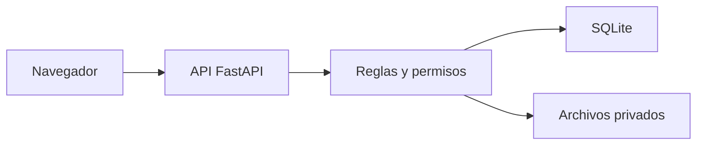
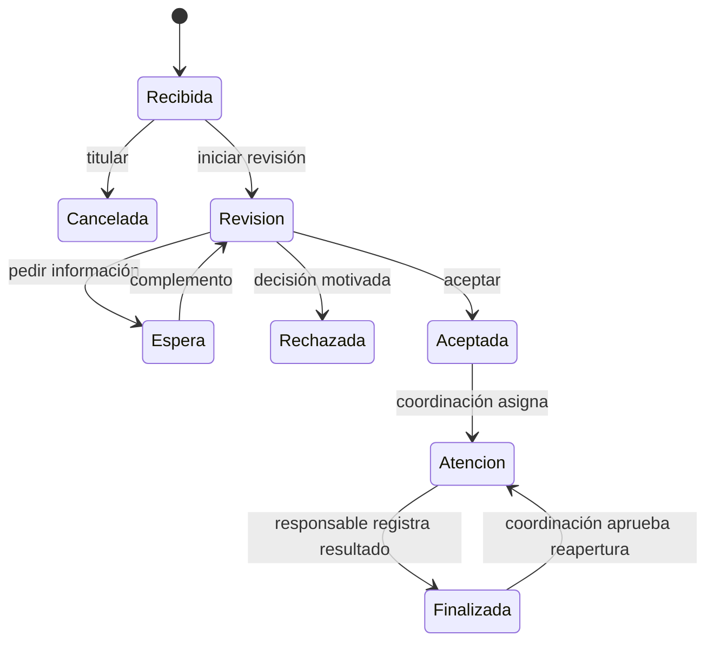
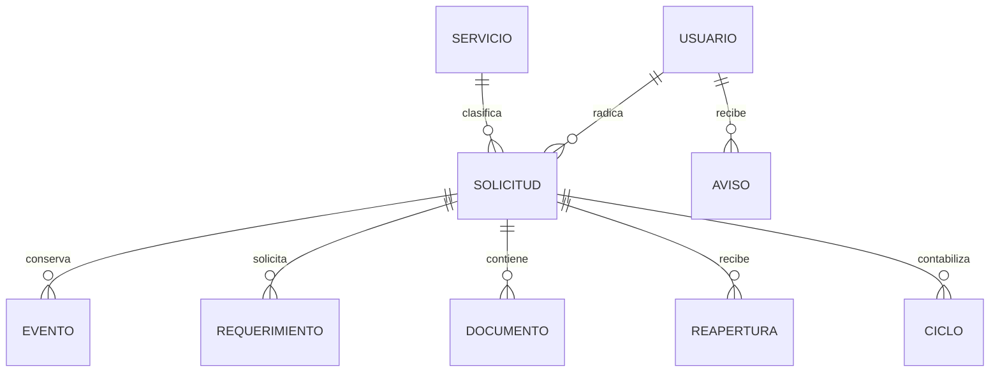

# Diseño técnico de Radivela

## Arquitectura

Elegí FastAPI para servir el frontend HTML, CSS y JavaScript y la API REST desde el mismo origen. Pydantic valida contratos. SQLAlchemy y Alembic gestionan SQLite. La API autentica con JWT, verifica cuenta activa, rol y relación con el recurso. Usar contraseñas con Argon2, secretos por entorno y documentación OpenAPI. Mantener los PDF en almacenamiento privado y entregar archivos únicamente tras comprobar permisos.

## Estados y permisos

Los estados activos Recibida, En revisión, En espera de información, Aceptada y En atención también admiten cierre por duplicado con las condiciones de RF-16. Corregir no cambia el estado. Una reapertura pendiente o rechazada conserva Finalizada. Solo coordinación asigna o resuelve reaperturas. El personal habilitado inicia revisión de casos disponibles y solo el gestor del caso puede evaluarlo o cerrar por duplicado, con facultad de cierre también para coordinación. El titular consulta sus propios casos y ve movimientos que le afectan. Coordinación consulta todos y da de alta al personal. El responsable asignado finaliza. Cada transición guarda historial en la misma transacción. Proteger operaciones concurrentes con actualización condicional de versión y responder 409 ante conflictos.

## Modelo de datos

| Entidad | Campos y restricciones principales |
|---|---|
| Usuario y usuario_rol | ID, nombre, documento, correo único normalizado, hash, activo. Roles acumulables con unicidad por usuario y rol. |
| Servicio | ID, nombre, disponible, prioridad y días hábiles. «Otro servicio» es opción de radicación para revisión. Si se acepta, se clasifica en un tipo disponible. |
| Solicitud | ID, radicado único inmutable, titular y servicio como FK, asunto, descripción, datos de contacto de radicación, estado, fechas, gestor, responsable, versión, referencia opcional al principal. |
| Evento | Caso, autor, tipo, fecha, motivo y visibilidad. Orden cronológico con ID como desempate. |
| Requerimiento | Caso, tipo texto o documento, detalle, estado y respuesta. Un requerimiento abierto por caso. |
| Documento | Caso, requerimiento o cierre relacionado, nombre seguro, tipo, tamaño, clave privada. Un PDF por requerimiento de documento. |
| Ciclo y cierre | Caso, inicio, término, pausas, prioridad y plazo aplicados, respuesta, resultado y responsable. Conservar cierres anteriores. |
| Reapertura | Caso y cierre de origen, motivo, fecha, decisión, decisor. Restricción de una pendiente por caso. |
| Aviso y calendario | Aviso con destinatario, evento y lectura. Calendario de festivos con fecha única y zona America/Bogota para cómputo. |

## Contratos REST

Prefijo `/api/v1`. Respuestas con datos mínimos para el rol. 201 para creación, 200 para consultas y cambios, 401 para sesión inválida, 403 para falta de permiso funcional, 404 para recurso inexistente o ajeno, 409 para conflicto de estado, 413 para archivo demasiado grande, 415 para archivo no admitido y 422 para entradas inválidas. Listados paginados y orden estable.

| RF | Ruta | Entrada y resultado |
|---|---|---|
| RF-01 | POST /auth/registro | Nombre, documento, correo y contraseña → cuenta solicitante. |
| RF-02 | POST /auth/login | Correo y contraseña → JWT con expiración. |
| RF-03 | POST /personal | Identidad, credenciales y roles internos → usuario activo. |
| RF-04 | POST /solicitudes | Seis campos del levantamiento → radicado y estado Recibida. |
| RF-05 | GET /solicitudes/{radicado} | Radicado de caso autorizado → detalle, estado y acciones disponibles. |
| RF-06 | PATCH /solicitudes/{radicado} | Campos editables y versión → solicitud corregida. |
| RF-07 | POST /solicitudes/{radicado}/cancelar | Versión → solicitud Cancelada. |
| RF-08 | GET /bandeja y POST /solicitudes/{radicado}/revision, /evaluacion | Filtros de bandeja o decisión con motivo y tipo de requerimiento → bandeja o nuevo estado. |
| RF-09 | POST /solicitudes/{radicado}/complementos | ID de requerimiento y texto o PDF → estado En revisión. |
| RF-10 | POST /solicitudes/{radicado}/asignacion | Responsable habilitado y versión → En atención. |
| RF-11 | GET /solicitudes/{radicado}/historial | Radicado → eventos visibles según permiso. |
| RF-12 | GET /avisos y PATCH /avisos/{id} | Paginación o marca de leído → avisos propios. |
| RF-13 | POST /solicitudes/{radicado}/finalizacion | Respuesta, resultado, versión y PDF si aplica → cierre. |
| RF-14 | GET /solicitudes/{radicado}/documentos/{id} | Identificador asociado al caso → descarga privada. |
| RF-15 | POST /solicitudes/{radicado}/reaperturas y PATCH /reaperturas/{id} | Motivo o decisión motivada y responsable sustituto si aplica → petición o resolución. |
| RF-16 | POST /solicitudes/{radicado}/duplicado | Radicado principal y motivo → Cerrada por duplicado. |
| RF-17 | PATCH /servicios/{id} | Prioridad y días → configuración para nuevas radicaciones. |
| RF-18 | GET /supervision | Estado, responsable, tipo, prioridad, fechas y paginación → filas y métricas. |

Para carga de PDF usar multipart, límite inicial de 10 MiB, validación de tipo y estructura básica, nombres de almacenamiento generados y descarga privada. La finalización de un certificado expedido requiere oficio PDF. Si falla una operación, limpiar archivos temporales y evitar registros incompletos. Guardar fechas en UTC y mostrar hora de Colombia.

## Frontend

**Propuesta A.** Fondo gris claro, navegación lateral verde petróleo, títulos de palo seco y acciones principales verdes. La tabla muestra progreso orientativo según el estado y acciones de consulta, complemento o respuesta. Encabezado propio con «Radivela» y «Portal de solicitudes de servicio». Sin escudo externo. Estados con texto y color, foco visible, etiquetas explícitas y mensajes de validación asociados a campos.

| Vista | Distribución y acción principal |
|---|---|
| Mis solicitudes | Encabezado, botón Nueva solicitud, búsqueda por radicado y tabla de casos. En móvil, filas apiladas con estado y acción visible. |
| Nueva solicitud | Formulario de seis campos, errores junto al campo y confirmación con radicado visible y copiable. |
| Detalle | Estado, historial visible, respuesta y acciones habilitadas, incluido complemento o descarga. |
| Atención | Filtros y bandeja, evaluación con motivo cuando aplique y atención de casos propios. |
| Coordinación | Bandeja completa, asignación, reaperturas, alta de personal, filtros y tiempos. |
| Acceso y avisos | Registro, inicio de sesión y listado de avisos con enlace al caso. |

Mostrar estados de carga, lista vacía y error controlado. WhatsApp queda como RF-19 opcional después de verificar el flujo base.
